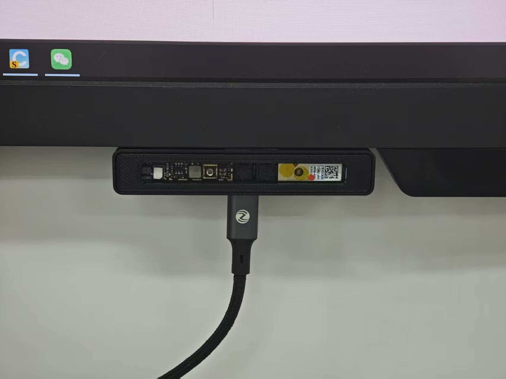
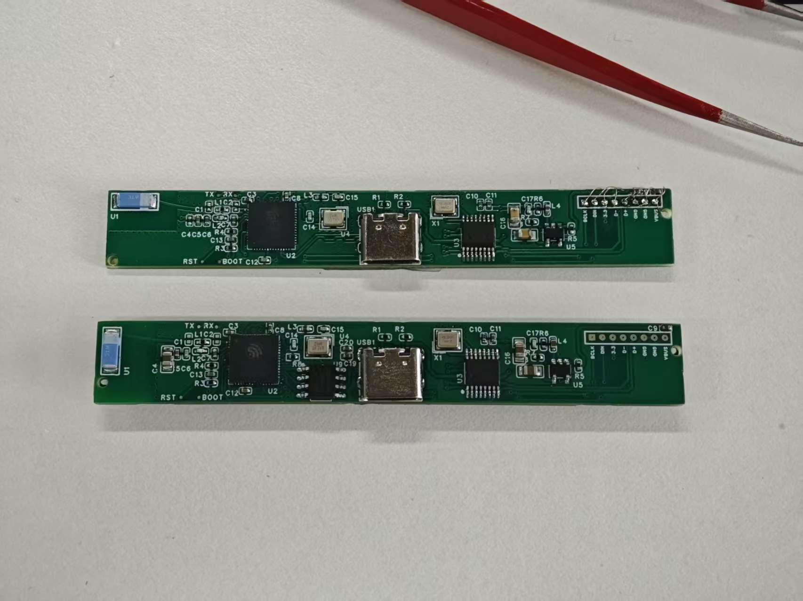
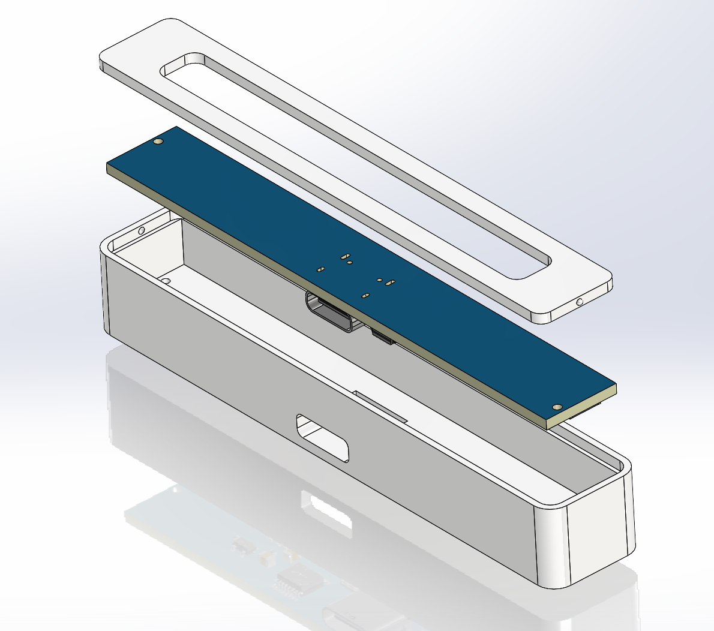

<div align="center">

# Windows Hello 摄像头 + 双麦克风

**一根 USB 线连接 Windows Hello 摄像头和双声道麦克风**

基于 0JCXG0 摄像头模组与 ESP32-S3 的开源硬件和固件方案

[](https://oshwhub.com/eda_nmeihcpcn/project_allrbxmz)

[项目介绍](#项目介绍) · [板卡版本](#板卡版本) · [实物展示](#实物展示) · [固件烧录](#固件烧录) · [源码编译](#源码编译) · [温湿度网关](#温湿度网关)

   



</div>

## 项目介绍

**硬件开源地址：[Windows Hello 摄像头 + 双麦克风](https://oshwhub.com/eda_nmeihcpcn/project_allrbxmz)**

项目的原理图、PCB、BOM、外壳模型、装配说明及通用固件均可在立创开源社区获取。

项目基于 0JCXG0 摄像头模组和 ESP32-S3，将 Windows Hello 摄像头与 USB 双麦克风集成在一起，适合人脸登录和视频语音通话。两种新版主板均使用四口 USB Hub，其中两路分别连接摄像头和 ESP32-S3 麦克风，另外两路未引出；固件还提供可选的蓝牙温湿度网关功能。

## 板卡版本

| 版本 | 说明 |
| --- | --- |
| Board1 | 原作者设计，使用独立 ESP32-S3 开发板。 |
| Board2 | 二次设计，采用 ESP32-S3FH4R2。 |
| Board3_NorFlash | 二次设计，采用 ESP32-S3 并外挂 NOR Flash，以降低成本。 |

两个新版板卡均已实物验证，使用相同的麦克风固件。原项目的另外两路 USB 接口引出为 USB-A 接口。

## 实物展示

两个新版板卡对比：上方为 ESP32-S3FH4R2 版，下方为外挂 NOR Flash 版。



外壳和板卡装配示意：需要 2 颗 M1.2×4.5 螺丝固定。盖子目前卡合不够牢固，可自行二次设计或使用胶水辅助固定。



## 固件烧录

1. 从立创开源项目附件下载通用合并固件，用 USB 数据线连接新版板卡的 USB-C 接口与电脑。
2. 使用 Chrome 或 Edge 打开 [ESP Launchpad](https://espressif.github.io/esp-launchpad/)，连接设备串口。
3. 在 DIY 页面选择下载的固件，烧录地址填写 `0x0`，烧录完成后重启设备。

如无法连接，请先让 ESP32-S3 进入下载模式。摄像头驱动和 Windows Hello 设置可参考[原作者项目](https://oshwhub.com/kojak/project_xdwifdbb)。

## 温湿度网关

固件源码支持通过蓝牙读取小米蓝牙温湿度计 2，并通过 Wi-Fi 和 MQTT 接入巴法云。通用固件未配置 Wi-Fi 和巴法云；需要该功能时，参考 `main/secrets.h.example` 创建 `main/secrets.h`，填写自己的配置后自行编译。

## 功能特性

- **双声道（Stereo）PDM 采集**：两颗 PDM 麦克风共享 CLK / DIN 总线，通过时钟边沿区分左右声道（ESP32-S3 立体声 PDM 模式），16-bit / 48 kHz
- **USB 标准 UAC 麦克风**：对电脑呈现为标准 USB 麦克风，无需安装驱动；可配合任意录音软件（WavePad、Audacity 等）使用
- **ALC 自动电平控制**：基于 `espressif/esp_audio_effects` ALC，自动补偿音量差异、抑制削波；可切换为内置自定义软件 AGC 后端
- **宿主音量控制（Manual Gain）**：电脑端麦克风音量滑块（0–100）映射到可配置增益范围，静音时归零
- **稳定的音频热路径**：除上电初始化外移除所有日志打印，避免 UART 阻塞导致周期性爆音

## 音频信号链路

```
PDM麦克风(左/右) → I2S PDM RX → [ALC 自动增益] → [Manual Gain 宿主音量] → USB UAC → PC
```

主链路见 [main/i2s_pdm_example_main.c](main/i2s_pdm_example_main.c) 中的 `uac_device_input_cb`（音频热路径，需保持精简，禁止在回调中加入阻塞调用/日志）。

## 硬件连接

按 PCB 适配，PDM 引脚定义在 [main/i2s_pdm_rx_stereo.c](main/i2s_pdm_rx_stereo.c)：

| 信号 | GPIO | 说明 |
| ---- | ---- | ---- |
| PDM CLK | GPIO 6 | 两颗麦克风共享时钟 |
| PDM DIN | GPIO 5 | 两颗麦克风共享数据线（左右声道由 SEL 引脚区分） |

> 左右声道交换通过 `clk_inv = true` 在硬件时钟相位层面实现

## 源码编译

环境要求：**ESP-IDF v6.0.2**（当前工程基于该版本编译验证，见 [dependencies.lock](dependencies.lock)）。

```bash
# 若使用 devcontainer / VS Code ESP-IDF 插件，IDF 路径见 .vscode/settings.json

idf.py set-target esp32s3
idf.py build
idf.py -p PORT flash monitor
```

### 主要依赖组件

| 组件 | 版本 | 用途 |
| ---- | ---- | ---- |
| `espressif/usb_device_uac` | ^1.3.1 | UAC 设备驱动（TinyUSB 封装） |
| `espressif/esp_audio_effects` | ^1.0.0 | ALC 自动电平控制 |
| `espressif/cmake_utilities` | ^1.1.1 | ESP 组件构建工具 |

## 配置（menuconfig）

```
idf.py menuconfig
```

### AGC Configuration（自动电平控制）

选择 ALC 后端：

- `AGC_BACKEND_ESP_AE`：基于 `esp_audio_effects` ALC（**当前默认，见 [sdkconfig](sdkconfig)**），预编译 SIMD 优化库，~3-5% CPU @48kHz 立体声
- `AGC_BACKEND_CUSTOM`：内置轻量软件 AGC，峰包络检测 + 压缩比 + 噪声门 + 软限幅，零外部依赖，见 [main/agc_processor.c](main/agc_processor.c)
- `AGC_BACKEND_NONE`：关闭 ALC（透传）

当前生效参数（sdkconfig）：目标电平 `-6 dBFS`、最大增益 `12 dB`、静音阈值 `-35 dBFS`、起音 `5 ms`、释放 `200 ms`、噪声门 `-60 dBFS`。

### Manual Gain Control（宿主音量增益）

- `MANUAL_GAIN_ENABLE`：启用手动增益级（位于 ALC 之后），增益由电脑端麦克风音量滑块控制
- `MANUAL_GAIN_MIN_DB` / `MANUAL_GAIN_MAX_DB`：音量 0 / 100 对应的增益（当前为 `-5 dB` / `+5 dB`，见 [sdkconfig](sdkconfig)；Kconfig 默认 0 / 24 dB）
- 静音时增益归零（`mute` 回调将增益置为 0）

## USB 描述信息

默认描述符（可在 menuconfig 中修改）：

- VID `0x303A`，PID `0x8000`
- Manufacturer：`Espressif`，Product：`ESP UAC Device`
- 采样率 `48000 Hz`，位深 `16-bit`，通道数 `2`（仅麦克风，`UAC_SPEAKER_CHANNEL_NUM=0`）
- USB 微帧间隔 `10 ms`

## 项目结构

```
├── main/
│   ├── i2s_pdm_example_main.c   # 主入口：初始化 PDM 通道 + ALC + 手动增益 + UAC
│   ├── i2s_pdm_rx_stereo.c      # 双声道 PDM RX 初始化（GPIO6/GPIO5，clk_inv 交换声道）
│   ├── i2s_pdm_tx.c             # PDM TX（遗留，当前未使用）
│   ├── agc_processor.c/.h       # ALC 封装（支持 esp_audio_effects / 自定义 / 关闭 三种后端）
│   ├── manual_gain.c/.h         # 宿主音量 → 线性增益
│   └── Kconfig.projbuild        # 工程配置菜单
├── sdkconfig.defaults           # 默认配置（PDM RX / 双声道 / ALC 自定义后端）
└── 16K_SAMPLE_RATE_OPTIMIZATION.md  # 16K 采样率底噪优化方案（记录用）
```

## 致谢与许可

本项目基于「权且可用」的 [USB HUB + Windows Hello 摄像头 + 麦克风](https://oshwhub.com/kojak/project_xdwifdbb) 二次开发，感谢原作者开源硬件设计和双麦克风方案。硬件项目采用 CC BY-NC-SA 4.0；固件代码及依赖组件的许可请分别参阅仓库中的许可证与各组件的许可声明。
